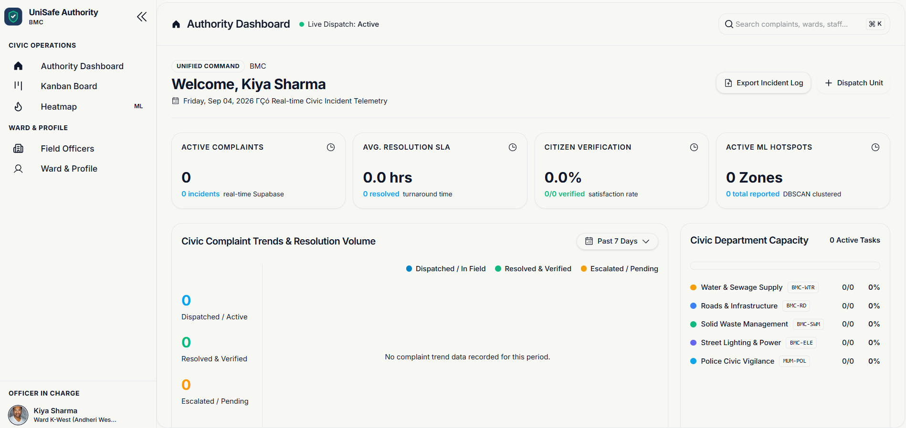
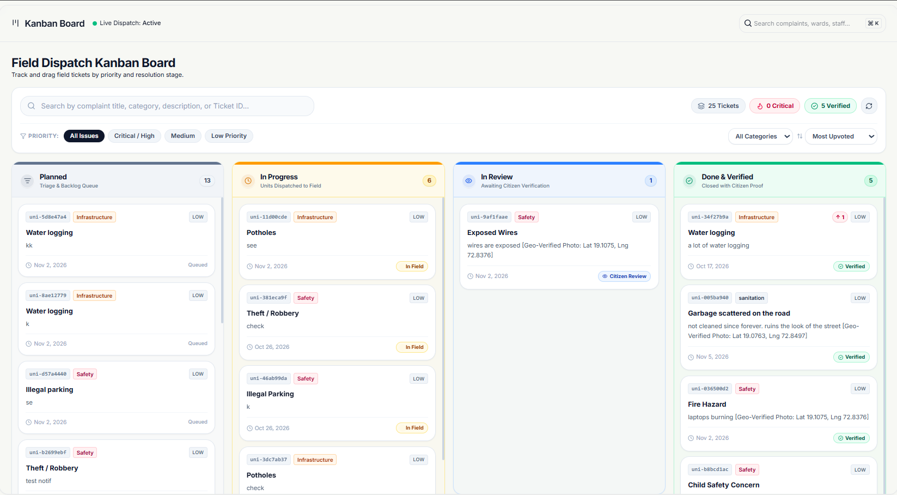
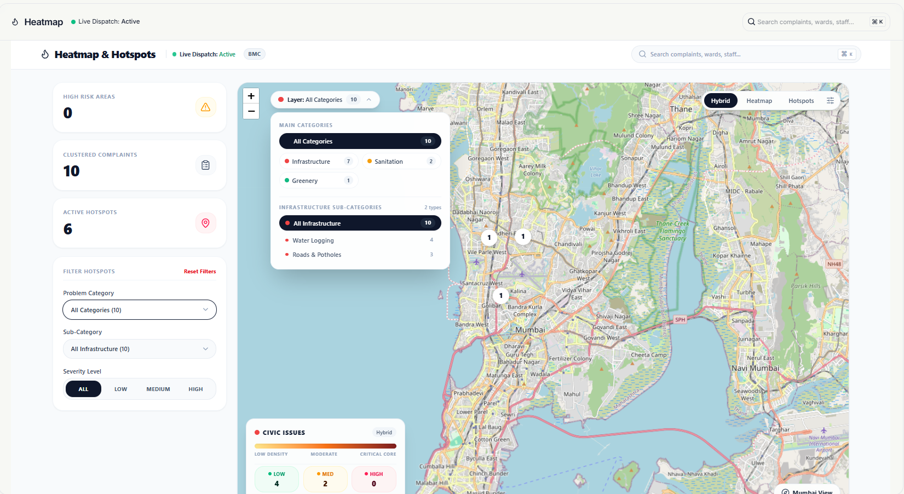
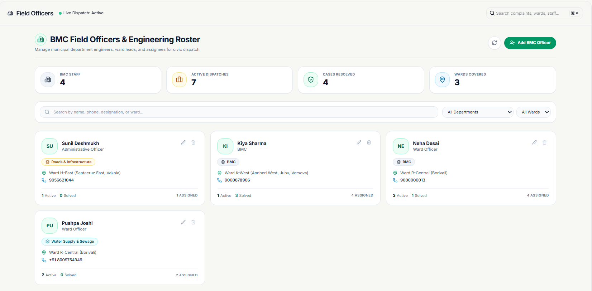
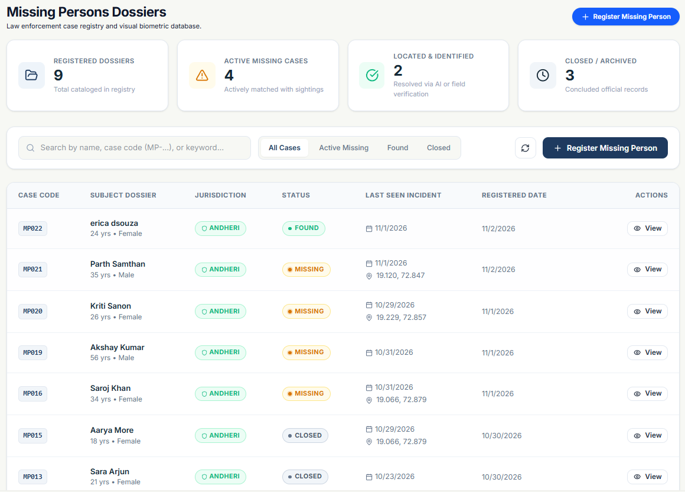
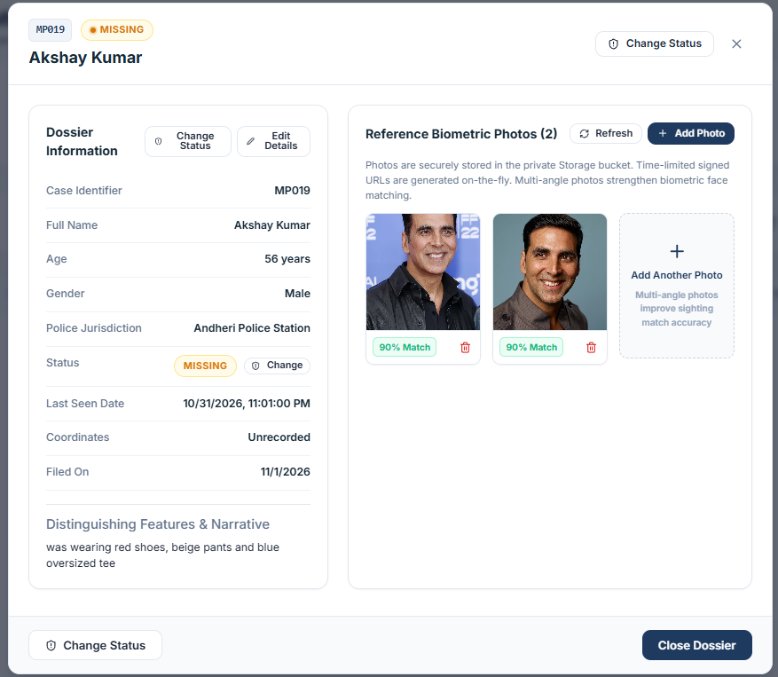
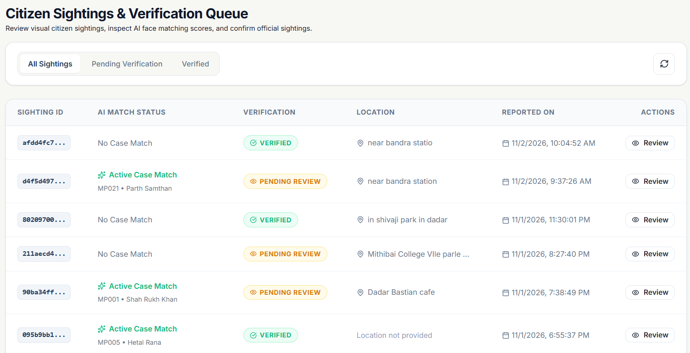
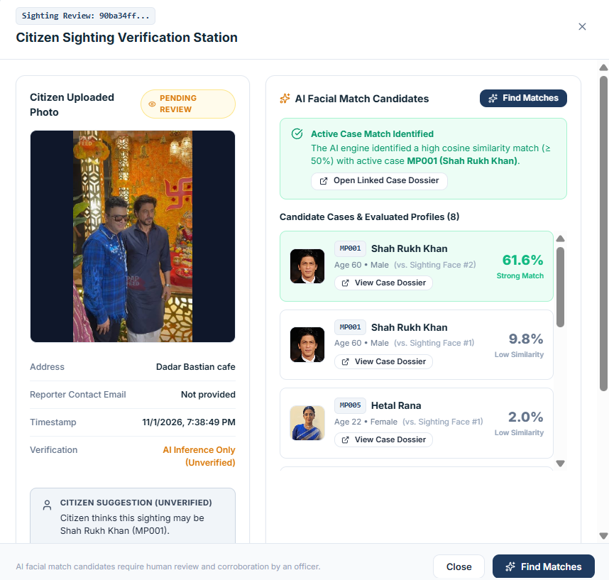

# UniSafe – Authority Web Application

The **UniSafe Authority Web Application** is a web-based platform designed to help government and law enforcement authorities manage civic complaints and public safety concerns. It provides separate interfaces for **Brihanmumbai Municipal Corporation (BMC)** and **Police authorities**, allowing them to monitor reported issues, manage cases, and coordinate responses through a centralised platform.

The application is part of the larger **UniSafe – AI-Assisted Missing Person Tracker & Civic Issue Management System**, which includes a Flutter-based citizen mobile application and a React-based authority web application.

## Application Preview

The following screenshots showcase the different modules available in the authority web application.

| Module | Screenshot |
|---|---|
| Authority Dashboard |  |
| Kanban Board |  |
| BMC Civic Issue Heatmap |  |
| Field Officer Management |  |
| Missing Person Management |  |
| Missing Person Registration |  |
| Citizen Sightings List |  |
| Finding Match |  |

## Key Features

### BMC Authority

- **Dashboard:** Provides an overview of reported civic issues and their current status.
- **Kanban Board:** Helps authorities track and manage complaints through different stages of resolution.
- **Civic Issue Heatmap:** Displays the geographical distribution and concentration of reported civic issues. It helps BMC authorities identify areas requiring attention and make informed decisions about resource allocation.
- **Ward and Field Officer Management:** Allows authorities to manage ward information and field officer details.
- **Notifications:** Provides updates related to complaints and authority activities.

### Police Authority

- **Safety Heatmap:** Displays reported safety-related issues across different locations. It helps police authorities identify areas with higher concentrations of reported safety concerns, understand where attention may be needed, and make informed decisions about resource allocation.
- **Missing Person Management:** Allows authorised personnel to register and manage missing-person cases.
- **Citizen Sightings:** Provides an interface to review sightings submitted by citizens and examine potential AI-generated matches to assist the verification process.
- **Notifications:** Provides updates about citizen sightings and other relevant activities.

### Shared Features

- Separate access and interfaces for BMC and Police authorities.
- Location-based visualisation of reported issues.
- Centralised access to relevant reports and case information.
- Integration with the UniSafe backend services.

## System Architecture

UniSafe consists of two frontend applications that communicate with shared backend services.

### Citizen Mobile Application

The citizen-facing application is built using **Flutter**. Citizens can report civic issues and submit missing-person sightings, including photographs and relevant location information.

### Authority Web Application

The authority-facing application is built using **React**. It provides separate interfaces for BMC and Police authorities to manage civic complaints, view heatmaps, manage missing-person cases, and review citizen-submitted sightings.

### Shared Flask Backend

Both the Flutter citizen application and the React authority web application communicate with the **same Flask backend for the missing-person module**.

The Flask backend handles missing-person and sighting-related API requests, image processing, face detection, and AI-assisted face matching using InsightFace.

**Example workflow:**

1. An authorised authority user registers a missing-person case through the authority web application.
2. A citizen submits a sighting through the Flutter mobile application.
3. The sighting is processed by the shared Flask backend.
4. The backend performs face detection and AI-assisted matching against registered missing-person records.
5. Potential matches are made available for review by authorities through the authority web application.

This shared backend allows missing-person registrations and citizen sightings submitted through the two different applications to be handled within the same system.

### Supabase

Supabase provides backend services used by the applications, including:

- Authentication
- PostgreSQL database
- Image and file storage

## Technology Stack

| Component | Technology |
|---|---|
| Frontend | React |
| Build Tool | Vite |
| Routing | React Router |
| Styling | Tailwind CSS |
| Authentication and Database | Supabase |
| Maps | Leaflet |
| Charts | Recharts |
| Icons | Lucide React |
| Missing-Person Backend | Python, Flask |
| Face Detection and Matching | InsightFace |
| Citizen Mobile Application | Flutter |

## Project Structure

```text
UniSafe_Authority_Web_Application/
│
├── public/
│
├── src/
│   ├── assets/
│   ├── components/
│   ├── screens/
│   │   ├── kanban-board/
│   │   └── ...
│   ├── pages/
│   ├── services/
│   ├── hooks/
│   ├── context/
│   └── ...
│
├── ss/
│   ├── BMC_Dashboard.png
│   ├── BMC-Kanban-Board.png
│   ├── BMC-Heatmap.png
│   ├── BMC-Ward-Officers.png
│   ├── Missing-Person-list.png
│   ├── MP-Profile.png
│   ├── MP-Sighting.png
│   └── MP-Find-Match.png
│
├── .env.example
├── package.json
├── vite.config.js
└── README.md
```

## Getting Started

Follow these steps to run the authority web application locally.

### Prerequisites

Make sure you have the following installed:

- [Node.js](https://nodejs.org/)
- npm
- Git

### 1. Clone the Repository

```bash
git clone https://github.com/itssmansi/UniSafe_Authority_Web_Application.git
```

Navigate into the project directory:

```bash
cd UniSafe_Authority_Web_Application
```

### 2. Install Dependencies

```bash
npm install
```

### 3. Configure Environment Variables

Create a `.env` file in the project root using `.env.example` as a reference.

Add the required environment variables and Supabase configuration.

Make sure the required credentials and configuration values are correctly set before running the application.

**Note:** Do not commit your `.env` file or expose private API keys in the repository.

### 4. Start the Development Server

```bash
npm run dev
```

Open the local URL displayed in the terminal to access the application.

### 5. Build for Production

To create a production build, run:

```bash
npm run build
```

## Running the Complete Missing-Person Module

The authority web application can be started independently. However, the complete missing-person functionality requires the shared Flask backend to be configured and running.

The Flask backend is maintained separately in the `flask_ai` directory of the main UniSafe FYP repository, under the `feature-ai` branch.

Refer to the [Flask backend directory](https://github.com/itssmansi/UniSafe_fyp/tree/feature-ai/flask_ai) for the backend implementation and setup instructions.

Both frontend applications communicate with this backend to support missing-person registration, citizen sighting submissions, face detection, and AI-assisted matching.

## Backend Repository

The Flask backend is maintained separately from this authority web application.

- **Authority Web Application (React):** This repository.
- **Citizen Mobile Application (Flutter):** Maintained in a separate repository.
- **Flask Backend:** Located in the `flask_ai` directory of the main UniSafe FYP repository.

**Main Repository:** [itssmansi/UniSafe_fyp](https://github.com/itssmansi/UniSafe_fyp)

The Flask backend provides the shared missing-person APIs used by both the citizen mobile application and the authority web application. It handles image processing, face detection, and AI-assisted face matching using InsightFace.

This keeps the backend implementation separate while allowing both frontend applications to interact with the same missing-person services.

## About UniSafe

**UniSafe – AI-Assisted Missing Person Tracker & Civic Issue Management System** aims to bring civic issue management and public safety services together through a connected digital platform.

By combining citizen reporting, authority dashboards, location-based heatmaps, and AI-assisted missing-person matching, UniSafe aims to support authorities in monitoring reported issues, reviewing information, and making informed decisions.

---

**Part of the UniSafe FYP Project**